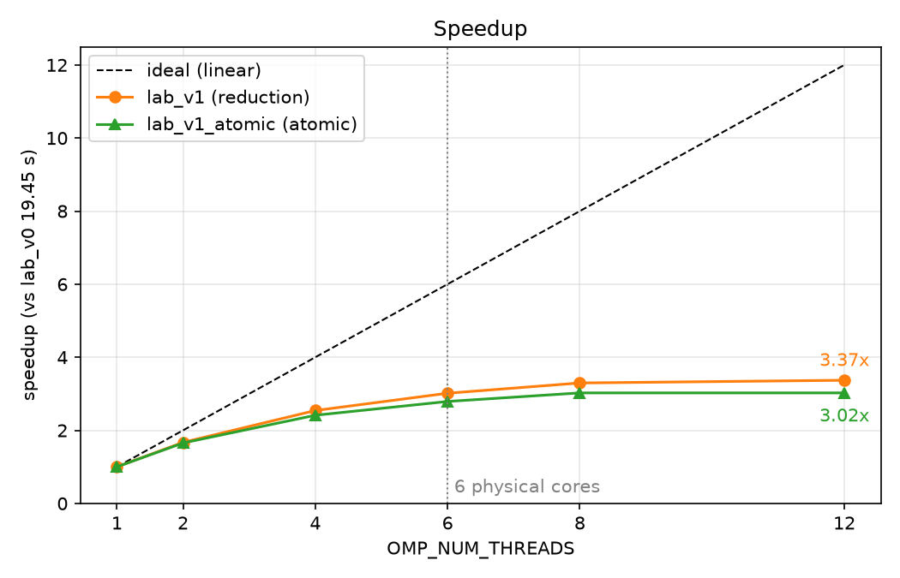
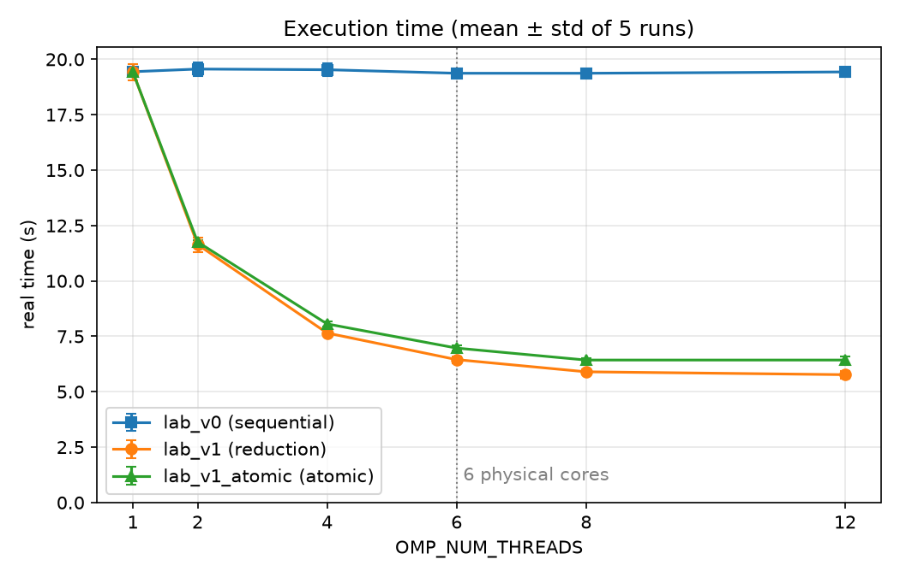

## 1. Name, Student ID,  School

---

白宇辰, 313554005, NYCU

## 2. Spec

---

> 本文件的數據為 2026-10-21 在目前電腦上重新執行的結果（每個設定跑 5 次取平均），原始作業的數據保留在 `result*.log` 並於下方表格中並列比較。
> 重現實驗的完整紀錄放在 `results_20261021/`（`env.txt` 為電腦與編譯參數，`run1` ~ `run5/` 為原始 log，`summary.md` 為統計表）。

### 1. **測試環境**

本次實驗在 WSL2 + Ubuntu 環境下進行，使用的硬體與系統規格如下（`lscpu`，詳見 `results_20261021/env.txt`）：

- **CPU 型號**：12th Gen Intel(R) Core(TM) i5-12400
- **實體核心數**：6 cores
- **執行緒數**：12 threads（每核心 2 執行緒）
- **架構**：x86_64，支援 64-bit 作業模式
- **Cache**：L1d 288 KiB / L1i 192 KiB / L2 7.5 MiB（各 6 份），L3 18 MiB 共享
- **記憶體**：15 GiB（WSL2 可用）
- **虛擬化**：執行於 Microsoft Hypervisor 上（WSL2）
- **作業系統**：Ubuntu 22.04.5 LTS on WSL2（kernel `6.18.54.1-microsoft-standard-WSL2`）

### 2. **編譯器與編譯選項**

- **Compiler**：`g++ (Ubuntu 11.4.0-1ubuntu1~22.04.3) 11.4.0`
- **Build tool**：GNU Make 4.3
- **OpenMP**：libgomp（`_OPENMP = 201511`，即 OpenMP 4.5）
- **Flags**：
    - `-fopenmp`：啟用 OpenMP 支援
    - `-O3`：最佳化（原 ReadMe 寫 `-O2`，但 `Makefile` 實際使用的是 `-O3`，兩次實驗皆為 `-O3`）
    - `-std=c++11`：指定 C++11 標準

```
CXX = g++
CXXFLAGS = -fopenmp -O3 -std=c++11
```

---

### 3. **其他調整**

- 使用 `Makefile` 管理專案編譯與執行，共三個程式：
    - `lab_v0`：原始序列版本
    - `lab_v1`：平行化版本（使用 `reduction`）
    - `lab_v1_atomic`：與 `lab_v1` 相同，只把 `atomicFlux` 改成 `#pragma omp atomic`，用於 Reduction 與 Atomic 比較
- `make run LOG=<file>` 依序執行三個程式，以 `/usr/bin/time -p` 記錄時間並寫入 log（預設 `result.log`）
- `lab.sh`：原始作業使用的腳本，固定 `OMP_NUM_THREADS=12`：

```bash
export OMP_NUM_THREADS=12
make
make run
make clean
```

- `reproduce.sh`：重現實驗用的腳本，記錄電腦與編譯參數，對 1/2/4/6/8/12 threads 各跑 `REPEAT` 次（預設 5，各 thread 數交錯執行以降低系統狀態漂移的影響），並輸出平均值與標準差：

```bash
./reproduce.sh                       # 預設設定
THREADS="1 12" REPEAT=3 ./reproduce.sh   # 自訂 thread 數與次數
```

- `plot.py`：讀取 `results_20261021/summary.md` 畫出實驗圖到 `figures/`（需要 `pip install matplotlib`）：

```bash
python3 plot.py
```

## 3. Result

---

### 1. Sequential 時，你跑的時間為何？最終結果為何（優化多少 %）？

重現實驗（5 次平均）：

- **原始版本 (lab_v0)**：30 次執行平均 **19.45 秒**（各組 19.37 ~ 19.56 秒）
- **平行版本 (lab_v1, OMP_NUM_THREADS=1)**：**19.43 秒**

`OMP_NUM_THREADS=1` 時與序列版幾乎一樣，表示 OpenMP 本身的額外開銷可忽略，因此以 **`lab_v0` 約 19.45 秒** 為 baseline。

平行化版本在 12 執行緒下為：

- **lab_v1 (OMP_NUM_THREADS=12)**：**5.77 秒**

計算效能提升比率：

$$
\text{Speedup} = \frac{19.45}{5.77} \approx 3.37 \times
$$

$$
\text{執行時間減少} = \left(1 - \frac{5.77}{19.45}\right) \times 100\% \approx 70.3\%
$$

**總結**：

| | 重現實驗（5 次平均） | 原始作業（單次） |
| --- | --- | --- |
| 原始版本 lab_v0 | 19.45 秒 | 17.56 秒 |
| 最佳版本 lab_v1（12 threads） | 5.77 秒 | 5.36 秒 |
| 整體加速比 | **3.37 倍** | 3.28 倍 |
| 執行時間減少 | **70.3%** | 69.5% |

重現實驗的絕對時間比原始作業慢約 5~10%，但加速比與減少比例非常接近，結論一致。

---

### 2. Scalability：用不同 thread 的數量測試，你覺得一切如同預期嗎？為什麼？

以下是各執行緒數量的實測時間（`real`，5 次平均 ± 標準差）與加速比（以 lab_v0 平均 19.45 秒為基準）：

| Threads | Time (s) | Speedup | 原始作業 Time (s) | 原始作業 Speedup |
| --- | --- | --- | --- | --- |
| 1 | 19.43 ± 0.37 | 1.00× | 18.53 | 0.95× |
| 2 | 11.64 ± 0.33 | 1.67× | 10.87 | 1.62× |
| 4 | 7.65 ± 0.10 | 2.54× | 8.32 | 2.11× |
| 6 | 6.45 ± 0.15 | 3.02× | 6.94 | 2.53× |
| 8 | 5.90 ± 0.10 | 3.30× | 5.33 | 3.29× |
| 12 | 5.77 ± 0.18 | 3.37× | 5.36 | 3.28× |



觀察結果：

- 加速效果 **符合預期**，2～6 執行緒時呈現穩定提升。
- 6 執行緒之後增幅明顯變小，8 到 12 執行緒幾乎沒再提升，出現 **平行化瓶頸**。
- 可能原因：
    - 某些段落（如 `velocity` 更新與 `criticalFlux` 計算）沒有平行化，成為瓶頸（Amdahl's Law）
    - i5-12400 只有 6 個實體核心，超過 6 threads 是靠 Hyper-Threading 共用運算單元，對 `sqrt` / `log1p` 這種計算密集的迴圈幫助有限
    - 記憶體頻寬競爭
- 從 `user` time 也看得出來：12 threads 時 `user` 為 37.47 秒（約為序列版 19.3 秒的 2 倍），表示多出來的 thread 大多在等待或做重複的同步工作，而非有效運算。

**總結**：

- 漸進式加速良好，超過實體核心數（6）後趨緩，8 執行緒後幾乎持平
- 重現實驗的趨勢與原始作業一致，整體來看平行化達到預期目標，但仍有部分瓶頸段可再優化

---

## 4. Implementation

1. 在哪裡加了 #pragma？為此做了什麼改動？優化了多少？

---

### (1) 初始化 `velocity` 和 `pressure`

```cpp
#pragma omp parallel for
for (int i = 0; i < numParticles; i++) {
    velocity[i] = i * 1.0;
    pressure[i] = (numParticles - i) * 1.0;
}
```

- **原因**：這段操作對每個元素獨立，適合平行處理。
- **效益**：初始化大量資料，加速非常明顯。

---

### (2) 初始化 `energy`

```cpp
#pragma omp parallel for
for (int i = 0; i < numParticles; i++) {
    energy[i] = velocity[i] + pressure[i];
}
```

- **理由同上**，屬於資料獨立運算。
- **可視為初始化階段平行的延續**。

---

### (3) 計算 `fieldSum`（雙層巢狀迴圈）

```cpp
#pragma omp parallel for reduction(+ : fieldSum)
for (int r = 0; r < gridRows; r++) {
    for (int c = 0; c < gridCols; c++) {
        fieldSum += sqrt(r * 2.0) + log1p(c * 2.0);
    }
}
```

- **處理規模最大**，共 2.5B 次運算。
- 使用 `reduction(+ : fieldSum)` 來避免競爭。
- **這段是主要效能瓶頸之一，平行化效益最大。**

---

### (4) 累加 `atomicFlux`

```cpp
#pragma omp parallel for reduction(+ : atomicFlux)
for (int i = 0; i < numParticles; i++) {
    atomicFlux += velocity[i] * 0.000001;
}
```

- 屬於簡單向量積和。
- 雖然時間不長，但也能平行加速。

---

### (5) 統計總和：`sumVelocity`, `sumPressure`, `sumEnergy`

```cpp
#pragma omp parallel for reduction(+ : sumVelocity, sumPressure, sumEnergy)
for (int i = 0; i < numParticles; i++) {
    sumVelocity += velocity[i];
    sumPressure += pressure[i];
    sumEnergy += energy[i];
}
```

- 三個加總可一起平行處理。
- 同樣使用 `reduction` 避免資料競爭。

---

### 整體效益分析：

從 `OMP_NUM_THREADS=12` 結果可知，**總執行時間從 19.45 秒降到 5.77 秒，執行時間減少約 70.3%**（原始作業為 17.56 → 5.36 秒，約 69.5%）。

其中：

- `fieldSum` 占最大運算量，加速效果顯著
- 初始化、加總與能量運算都成功應用平行化
- 所有版本、所有 thread 數（共 90 次執行）輸出結果皆與序列版相同：

```
fieldValue      = 5.53321e+11
energy[0]       = 1e+07
Sum(velocity)   = 2.90484e+07
Sum(pressure)   = 5e+13
Sum(energy)     = 1e+14
atomicFlux      = 29.0484
criticalFlux    = 5.61032e+07
```

## 5.Experiment & Analysis

1. 為什麼認為 ... 這樣優化最好？其他跑出來的時間如何？相關解釋？

---

### 分析：

- 對於 **累加總和類型的問題**（如 `sumX += ...`），OpenMP 官方建議使用 `reduction` 而非 `atomic`。
- `#pragma omp atomic` 適用於 **極小範圍的寫入競爭**，但在大量迴圈中會因為頻繁進行記憶體同步造成效能下降。
- 在測試中，將 `atomicFlux` 區段使用 `reduction` 效能會比 `atomic` 顯著更好。
- 部分區段（如 `criticalFlux`）因為存在跨次迴圈依賴，無法簡單平行化，也不能使用 `atomic` 或 `reduction`。

### 使用 `#pragma omp atomic` 的比較實驗

我把 `lab_v1.cpp` 複製一份為 `lab_v1_atomic.cpp`，將 `reduction` 改為 `#pragma omp atomic`，也就是將：

```cpp
#pragma omp parallel for reduction(+ : atomicFlux)
    for (int i = 0; i < numParticles; i++) {
        atomicFlux += velocity[i] * 0.000001;
    }
```

改成

```cpp
#pragma omp parallel for
for (int i = 0; i < numParticles; i++) {
    #pragma omp atomic
    atomicFlux += velocity[i] * 0.000001;
}
```

其餘程式碼完全相同。實測結果（`real`，5 次平均 ± 標準差）：

| Threads | reduction (s) | atomic (s) | atomic 慢了 | reduction `user` (s) | atomic `user` (s) |
| --- | --- | --- | --- | --- | --- |
| 1 | 19.43 ± 0.37 | 19.43 ± 0.17 | 0.0% | 19.31 | 19.33 |
| 2 | 11.64 ± 0.33 | 11.76 ± 0.08 | 1.0% | 20.46 | 20.70 |
| 4 | 7.65 ± 0.10 | 8.06 ± 0.13 | 5.4% | 22.36 | 23.99 |
| 6 | 6.45 ± 0.15 | 6.97 ± 0.12 | 8.1% | 25.06 | 27.85 |
| 8 | 5.90 ± 0.10 | 6.43 ± 0.08 | 9.0% | 28.56 | 32.70 |
| 12 | 5.77 ± 0.18 | 6.43 ± 0.18 | **11.4%** | 37.47 | 45.31 |



在 12 執行緒下 `atomic` 版本為 **6.43 秒**，相比 `reduction` 版本的 **5.77 秒**，慢了約 **11.4%**（原始作業為 5.75 vs 5.36 秒，慢約 7.3%）。

**分析：**

- `atomic` 每一次寫入都要對同一個記憶體位置做 atomic 操作（`double` 的 atomic add 在 x86 上是 CAS 迴圈），執行緒間需要搶同一條 cache line，同步開銷變大。
- 1 thread 時沒有競爭，兩者時間相同；thread 數越多，競爭越激烈，差距從 1% 一路擴大到 11.4%，`user` time 的差距（12 threads 時多 7.8 秒）也反映了多出來的同步成本。
- 對於這種大量累加的場合，`reduction` 讓每個 thread 保有自己的局部暫存變數，在最後再合併，效能更佳。
- 雖然 `atomic` 可以保證正確性，但對效能較敏感的區段並不建議使用。

**結論：**

實驗結果驗證了理論上的推論——在大量加總的平行區段中，`reduction` 明顯優於 `atomic`，且差距隨 thread 數增加而擴大。

## 6. 其他補充

---

這次實作讓我學到了多種平行化的技巧與工具

### 1. **平行化方式的選擇會明顯影響效能**

- 使用 `#pragma omp parallel for reduction(...)` 在處理大規模資料累加時，效能遠優於 `atomic` 或 `critical`。
- `reduction` 能讓每個 thread 使用區域變數累積，最後再合併，效率高。
- 而 `atomic` 雖然也能避免資料競爭，但每次存取都會有鎖的開銷，在密集迴圈中效果差。

### 2. **工具與觀察**

- 學會使用 `lscpu` 了解 CPU 架構
- 設定 `OMP_NUM_THREADS`、觀察 `user/real/sys` 等指標，幫助我定位效能變化與執行時間差異來源

### 3. **重現實驗的注意事項**

- 單次量測的誤差可達數個百分點（例如重現時單次跑出的 lab_v0 介於 19.3 ~ 21.0 秒），因此重現時每個設定跑 5 次並記錄平均與標準差。
- 不同 thread 數交錯執行，避免系統狀態（溫度、背景程式、WSL2 排程）隨時間變化而只影響某一組數據。
- 重現時的絕對時間比原始作業慢約 5~10%，推測與當下的 Windows 電源設定 / 背景負載有關，但加速比與 reduction vs atomic 的結論皆一致。
